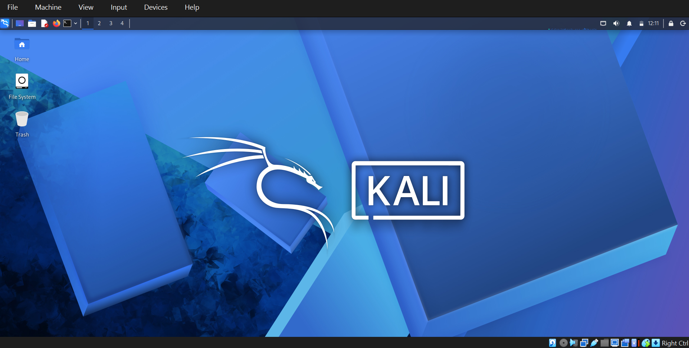

# networkwalks-B084-week1-cybersecurity-lab setup
Cybersecurity Lab Setup
#Kali Linux VM-Permanent Network Setup
## Configuration
-OS Kali Linux 2026.1
-Network:NAT Network (NatNetwork) 10.0.0.0/24
-Static IP:10.0.0.2/24
-Gateway:10.0.0.1
DNS:8.8.8.8
-Snapshot: Kali_Final_10.0.0.2
## Steps Completed
1. Created NAT Network in VirtualBox
2. Set VM adapter to NAT Network
3. Configured/etc/network/interfaces for static IP
4. Set DNS in/etc/resolv.conf
5. Verified with ping 8.8.8.8 and ping google.com
6. Enabled Bidirectional clipboard & Shared Folder
7. Created final snapshot
## Verification
ip a shows 10.0.0.2
ping tests successful
snapshot saved
## screenshots

## Kali Linux in VirtualBox

## Kali Linux Desktop

